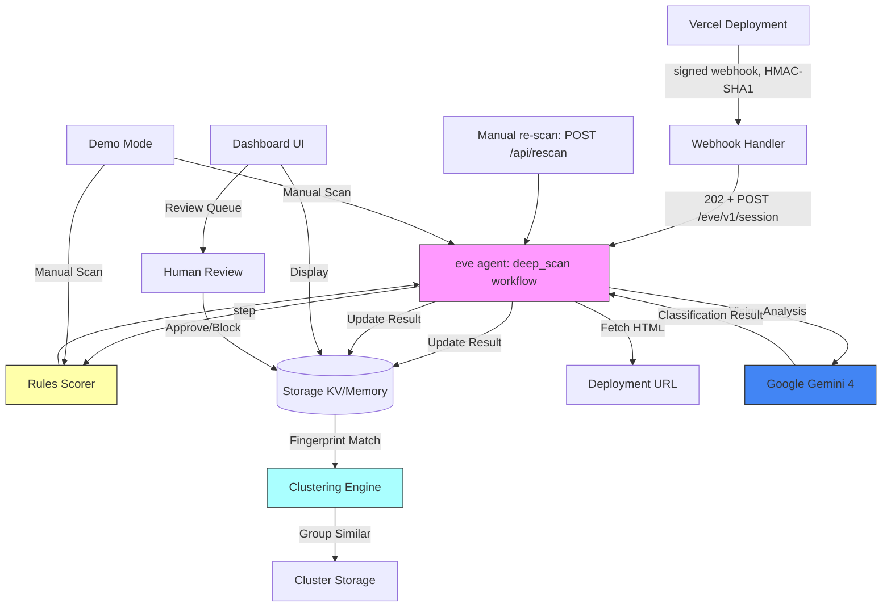

# Argon Guard

A Vercel integration that automatically scans every deployment for phishing and abuse using rules-based detection plus Google Gemini vision analysis. The durable deep scan and the scanning agent run on [eve](https://www.npmjs.com/package/eve), Vercel's filesystem-first framework for durable backend AI agents (see [What uses eve](#what-uses-eve)).

**Built for:** CV Gemini 4 Argon Hackathon + Vercel Trust & Safety interview design showcase

## Architecture



## Policies

The scanner evaluates every deployment against four abuse categories plus a benign category (`phishing`, `scam`, `hate_harassment`, `violent_extremism`, `benign`) and returns the single most severe applicable category:

- **Phishing (`phishing`):** Brand impersonation and credential, payment-card, SSN, or seed-phrase harvesting on unrelated or typosquat domains.
- **Scams (`scam`):** Fake giveaways, crypto-doubling schemes, advance-fee fraud, fake stores, and tech-support scams even when no login form is present.
- **Hate and harassment (`hate_harassment`):** Content that attacks, dehumanizes, or incites hatred, exclusion, or expulsion against people based on protected attributes (religion, race, ethnicity, national origin, sexual orientation, gender identity, disability), such as antisemitic conspiracy claims, comparing a group to vermin or parasites, or targeted harassment and doxxing of individuals.
- **Violent extremism (`violent_extremism`):** Glorification, recruitment, or support for violent extremist groups or ideologies, including praising mass shooters, distributing violent manifestos, or recruiting for armed race-war militias.
- **Counter-speech and educational exemption (`benign`):** News reporting on hate crimes or extremism, history and Holocaust museum education, counter-speech and debunking pages, academic research, policy documentation, and fiction or reviews that discuss hate without endorsing it are scored benign (`<= 0.1`). The test is whether a page endorses or promotes abuse, not whether it mentions or quotes it to condemn it.

Demo fixtures and live preview routes:
- `/demo` (supports `?sample=<slug>` query parameters)
- `/fixtures/hate-group` (fictional hate-group landing page fixture, `noindex`)
- `/fixtures/anti-hate-education` (benign counter-speech / education fixture, `noindex`)
- `/fixtures/fake-paypal`, `/fixtures/fake-microsoft`, `/fixtures/legit-bank`

Run the synthetic hate and extremism evaluation (20 hand-written pages: 10 abusive, 10 tricky benign):
```bash
npx tsx scripts/eval-hate.ts
npx tsx scripts/eval-hate.ts --rules-only
npx tsx scripts/check-rules-fpr.ts
```

## What It Does

### 1. Runtime Rules Check (Fast, Synchronous)
On every deployment webhook. A login form alone is normal, and so is a brand name alone (security blogs, docs), so context signals only count when the page **collects data**:

| Signal | Weight |
|---|---|
| Password form | 0.15 (alone stays clean) |
| Card / SSN / seed-phrase / OTP fields | 0.30 |
| Collects data + a third-party brand in title, headings, buttons, labels or logo alt (not on that brand's domain; "Sign in with Google" SSO buttons ignored) | 0.35 |
| Collects data + form posts to a different site | 0.30 |
| Collects data + urgency language ("suspended", "within 24 hours", "unpaid fee") | 0.15 |
| Typosquat hostname (`paypa1`, `rnicrosoft`) | 0.50 |
| CLI deploy without git / new account (< 7 days) | 0.15 / 0.10 |

Score is capped at 1.0. `__tests__/rules-holdout.test.ts` checks the rules against hand-written pages that are not in the benchmark (SSO buttons, words like "apple" and "chase", off-site form posts), so tuning can't simply memorise the benchmark.

### 2. Two-tier Gemini Scan
- **Tier 1, every deploy:** `gemini-3.8-flash` (low thinking, ~3.5 s, ~$0.0008/scan)
- **Tier 2, escalation only:** `gemini-4-argon` with heavy thinking (`thinkingLevel: 'high'`, ~10 s, ~$0.008/scan) when the Flash score is >= 0.4, the rules score is >= 0.3, or tier 1 fails
- Once Argon runs, its verdict decides the status; rules only decide whether to escalate
- Returns structured JSON: score, impersonated brand, reasons
- Screenshot capture is still stubbed (HTML only)

Configure with `GEMINI_FAST_MODEL`, `GEMINI_DEEP_MODEL`, `GEMINI_FAST_THINKING_LEVEL`, `GEMINI_DEEP_THINKING_LEVEL` and `GEMINI_ESCALATION_THRESHOLD`. "Gemini 3.8 Flash Cyber" is only listed on Google Cloud's Agent Platform (Vertex AI), not in the Gemini Developer API, so the AI Studio key uses `gemini-3.8-flash`.

### Benchmark
Full write-up: [`bench/results.md`](bench/results.md). There are two datasets, reported separately.

**Real-world: [PhreshPhish](https://huggingface.co/datasets/phreshphish/phreshphish)** ([arXiv:2507.10854](https://arxiv.org/abs/2507.10854), CC BY 4.0, anti-phishing research only). The sample is 250 archived real pages from the paper's "full" benchmark split, 125 phishing and 125 benign, drawn at random with seed 42 (Oct 25, 2026). Pages are stored HTML from the dataset; nothing fetches a live phishing page.

| Config | Precision | Recall | F1 | FPR | AP | p50 latency | Cost / scan |
|---|---|---|---|---|---|---|---|
| rules-only | 57.1% | 3.2% | 0.061 | 2.4% | 0.511 | 0.5 ms | $0 |
| flash-only | 100.0% | 71.2% | 0.832 | 0.0% | 0.960 | 3625 ms | $0.00286 |
| argon-only | 98.9% | 75.2% | 0.855 | 0.8% | 0.919 | 9535 ms | $0.01387 |
| rules+argon | 95.9% | 75.2% | 0.843 | 3.2% | 0.916 | 9535 ms | $0.01387 |
| tiered (36% escalated) | 100.0% | 69.6% | 0.821 | 0.0% | 0.956 | 3998 ms | $0.00873 |

Published baselines on the full PhreshPhish benchmark (paper Table 4, 24% base rate) are AP 0.978 for fine-tuned GTE and AP 0.922 for zero-shot Gemini-2.5-Pro. Our run used a smaller, balanced sample and only the first 8k chars of HTML, so the numbers are not directly comparable; see `bench/results.md` for details.

Takeaways:
- The rules depend on Vercel deployment metadata, so on raw pages they add almost nothing.
- Flash gives the best precision for the cost.
- Most misses are scam pages with no form in the first 8k chars (see `bench/results.md` for the planned fix).

**Demo set (synthetic):** `bench/dataset.ts` holds 24 hand-written phishing kits and 23 benign pages. This set is a sanity check, not an accuracy claim.

| Config | Precision | Recall | F1 | FPR | p50 latency | Cost / scan |
|---|---|---|---|---|---|---|
| rules-only | 100.0% | 95.8% | 0.979 | 0.0% | 0.16 ms | $0 |
| flash-only | 100.0% | 100.0% | 1.000 | 0.0% | 3704 ms | $0.00077 |
| argon-only | 100.0% | 100.0% | 1.000 | 0.0% | 9378 ms | $0.00804 |
| tiered (51% escalated) | 100.0% | 100.0% | 1.000 | 0.0% | 11369 ms | $0.00559 |

A legitimate shop checkout that collects card numbers still scores 0.30 and is sent to review.

Run the benchmarks:
```bash
npm run bench -- --dataset demo                  # synthetic set
python3 scripts/prepare_phreshphish.py           # needs huggingface_hub + pyarrow; writes bench/data/ (gitignored)
npm run bench -- --dataset phreshphish --estimate # print the expected Gemini cost first
npm run bench -- --dataset phreshphish           # about $4 for 250 pages
npm run bench -- --dataset phreshphish --rules-only
```

### What uses eve
- `agent/agent.ts`: the eve agent (Gemini 3.8 Flash, direct `@ai-sdk/google` provider).
- `agent/tools/deep_scan.ts`: a durable workflow tool (`"use workflow"`). Each stage is a retryable `"use step"`: fetch HTML, rules, Flash, Argon (only on escalation), then persist with clustering.
- `agent/tools/list_deployments.ts`: lists stored deployments by status for batch re-scans.
- No scheduled jobs. Scans run on deploy (webhook) and on demand. `POST /api/rescan` (bearer `EVE_SCAN_TOKEN`) re-scans `review` and `flagged` deployments when you call it; `examples/scheduled-rescan.md` shows how a cron re-scan would be wired, as a proof of concept only.
- `agent/channels/eve.ts`: `/eve/v1/*` behind auth (an `EVE_SCAN_TOKEN` bearer, Vercel OIDC, or localhost in dev).
- `pages/api/webhooks/vercel.ts`: verifies the signature, then starts an eve session (`eve/client`) and returns 202. If eve is unreachable or `EVE_HANDOFF=off`, it falls back to the same pipeline inline.
- `next.config.ts` wraps the app in `withEve()`, so Next serves the UI and API and eve runs as a second service in the same Vercel project. eve needs **Node 24**.

### Webhook signature
Vercel signs the **raw** request body with `hex(HMAC-SHA1(secret, body))` in `x-vercel-signature`. The route disables Next's body parser, checks the raw bytes with `timingSafeEqual`, and parses JSON only after the check passes. For integration webhooks the secret is the integration's Client Secret (set `VERCEL_INTEGRATION_WEBHOOK_SECRET` to it, or rely on the `VERCEL_CLIENT_SECRET` fallback). For account webhooks it is the secret shown when the webhook is created.

### 3. Clustering for Repeat Offenders
- **Exact hash**: SHA-256 of page content
- **SimHash**: Near-duplicate detection (64-bit fingerprint, Hamming distance matching)
- Groups flagged pages into clusters to identify phishing kits used across projects

### 4. Human Review Queue
- Low scores (< 0.3): auto-pass
- Medium (0.3-0.6): human review queue
- High (≥ 0.6): flagged, alerts raised
- Auto-pause (optional, off by default, requires eve human-in-the-loop approval)

### 5. Dashboard
- Recent scans with scores and reasons
- Review queue with approve/dismiss/block actions
- Cluster view showing grouped campaigns
- Metrics: total scans, clean, flagged, clusters

### 6. Demo Mode
- Sample phishing pages (fake PayPal, Microsoft)
- Manual URL scanner
- Full pipeline test without real integration

## Tech Stack

- **Framework**: [eve](https://www.npmjs.com/package/eve) - Vercel's durable agent framework
- **Frontend**: Next.js 16 + React 19
- **Storage**: Neon Postgres via `@neondatabase/serverless` (legacy Redis and local memory fallback)
- **Auth**: Neon managed Better Auth, with Google sign-in
- **Models**: Gemini 3.8 Flash (tier 1) and Gemini 4 Argon with heavy thinking (tier 2) via `@ai-sdk/google`
- **Deployment**: Vercel (Workflow + Sandbox)

## Setup

### Prerequisites
- Node.js 24 (required by eve; `engines.node` is `24.x`)
- Vercel account
- Google Cloud account (for Gemini API key)

### 1. Clone and Install
```bash
git clone https://github.com/DasilvaKareem/trust-safety-agent.git
cd trust-safety-agent
npm install
```

### 2. Environment Variables
Copy `.env.example` to `.env.local`:

```bash
cp .env.example .env.local
```

Required for production:
- `VERCEL_CLIENT_ID` - From Vercel Integration Console
- `VERCEL_CLIENT_SECRET` - From Vercel Integration Console
- `VERCEL_INTEGRATION_WEBHOOK_SECRET` - Webhook signing secret (the integration Client Secret; falls back to `VERCEL_CLIENT_SECRET`)
- `EVE_SCAN_TOKEN` - Bearer token that the webhook uses to start eve sessions
- `GOOGLE_GENERATIVE_AI_API_KEY` - Gemini API key from Google Cloud
- `DATABASE_URL` / `DATABASE_URL_UNPOOLED` - Neon pooled runtime and direct migration connections
- `NEON_AUTH_BASE_URL` / `NEON_AUTH_COOKIE_SECRET` - Neon Auth endpoint and cookie signing secret
- `AUTH_SECRET` - Encryption key for Vercel integration tokens
- `CRON_SECRET` - Scheduled monitoring authorization

For local dev:
- `NEXT_PUBLIC_APP_URL=http://localhost:3000`

### 3. Create Vercel Integration
1. Go to [Vercel Integration Console](https://vercel.com/dashboard/integrations/console)
2. Create new integration:
   - **Name**: Argon Guard
   - **Redirect URL**: `http://localhost:3000/api/integration/callback` (dev) / your production URL
   - **Webhook URL**: `http://localhost:3000/api/webhooks/vercel` (dev) / your production URL
   - **Events**: `deployment.created`, `deployment.ready`
3. Copy Client ID and Client Secret to `.env.local`

### 4. Get Gemini API Key
1. Go to [Google AI Studio](https://aistudio.google.com/app/apikey)
2. Create API key
3. Add to `.env.local` as `GOOGLE_GENERATIVE_AI_API_KEY`

### 5. Connect Neon through Vercel

```bash
vercel link
vercel integration add neon --name argon-guard-db --plan free_v3 -m region=iad1 -m auth=true
vercel env pull .env.local --environment development
npm run db:migrate
```

Keep the generated secrets in `.env.local` and configure matching values in Vercel.
`npm run build` applies the idempotent SQL migration before building. It uses the direct
connection for migrations; runtime queries use the pooled connection. Without Neon or
legacy Redis, local scanner storage is temporary; production fails closed.

## Development

### Run Locally
```bash
npm run dev
```

Visit `http://localhost:3000`

### Demo Mode
No integration needed:
1. Go to `http://localhost:3000/demo`
2. Select a sample phishing page or enter a custom URL
3. Click "Scan" to run the full pipeline

**Note**: Gemini analysis gracefully skips if no API key is set, returning an explicitly labeled rules-only result.

### Run Tests
```bash
npm test
```

Tests cover:
- Rules scorer (signals, plus hand-written hold-out pages that are not in the benchmark)
- SimHash clustering (Hamming distance, similarity matching)
- Webhook signature: real HMAC-SHA1 over a raw body; rejects re-serialized or tampered bodies, the wrong secret, sha256 digests and missing headers; tests the handler with the body parser off

### Build
```bash
npm run build
```

## Deployment

### Deploy to Vercel
1. Link project:
   ```bash
   npx vercel link
   ```

2. Add environment variables in Vercel Dashboard

3. Deploy:
   ```bash
   npx vercel --prod
   ```

4. Update integration callback URLs to production domain

### Integration Install Flow
1. User installs integration from Vercel marketplace
2. OAuth callback exchanges code for access token
3. Webhook registered for `deployment.*` events
4. Installation stored in Postgres
5. Future deployments trigger webhook → scan → store → alert

## File Structure

```
.
├── lib/
│   ├── storage/         # Postgres/legacy Redis storage layer
│   ├── rules/           # Fast rules-based scorer
│   ├── fingerprint/     # Content hashing + SimHash
│   └── gemini/          # Gemini vision analysis
├── pages/
│   ├── api/
│   │   ├── integration/ # OAuth callback
│   │   ├── webhooks/    # Vercel deployment webhooks
│   │   ├── review.ts    # Review queue actions
│   │   └── demo/        # Demo scan endpoint
│   ├── index.tsx        # Dashboard
│   ├── demo.tsx         # Demo mode
│   ├── clusters.tsx     # Cluster view
│   └── integration/
│       └── success.tsx  # Install success
├── __tests__/           # Jest tests
├── .env.example         # Environment template
└── README.md            # This file
```

## Extending

### Add More Rules
Edit `lib/rules/index.ts`:
- Add keywords to `BRAND_KEYWORDS` array
- Add patterns to typosquat regex list
- Adjust score weights in `computeRulesScore()`

### Change Gemini Models
Set env vars (defaults shown):
```bash
GEMINI_FAST_MODEL=gemini-3.8-flash
GEMINI_DEEP_MODEL=gemini-4-argon
GEMINI_DEEP_THINKING_LEVEL=high
```

### Add Screenshot Capture
Implement `takeScreenshot()` in `lib/gemini/index.ts`:
- Option 1: Playwright in Vercel Sandbox
- Option 2: Third-party screenshot API (ScreenshotOne, Urlbox)
- Option 3: Vercel Serverless Function with Puppeteer

### Enable Auto-Pause
1. Implement eve human-in-the-loop tool (see `eve` docs)
2. Call Vercel API to pause deployment
3. Require approval before action
4. Never auto-pause established accounts

## Demo Script

1. **Start dev server**: `npm run dev`
2. **Visit demo**: http://localhost:3000/demo
3. **Scan fake PayPal**: Select "Fake PayPal Login" → Scan
   - Rules score: 100% (password form + PayPal branding + typosquat)
   - Gemini score: ~90% (if API key set)
   - Status: Flagged
4. **Scan clean page**: Select "Legitimate Banking Site" → Scan
   - Rules score: 0%
   - Status: Clean
5. **View dashboard**: http://localhost:3000
   - See recent scans
   - Review queue (if any medium-risk scans)
6. **View clusters**: http://localhost:3000/clusters
   - See grouped similar pages

## Limitations (MVP)

- Screenshot capture is stubbed (returns `undefined`)
- No real deployment pause (requires HITL approval flow)
- In-memory storage lost on restart (use KV for persistence)
- No user authentication on dashboard (add before production)
- Gemini rate limits not handled
- In-memory storage is per-process: without KV, the Next app and the eve service do not share scan results

## Next Steps

1. Implement screenshot capture with Playwright
2. Add eve human-in-the-loop approval for auto-pause
3. Wire alerting into the re-scan flow (see examples/scheduled-rescan.md)
4. Add dashboard authentication
5. Tune Gemini prompt with production examples
6. Add monitoring and alerting (Sentry, Datadog)
7. Implement deployment pause via Vercel API

## License

ISC

## Credits

Built for the CV Gemini 4 Argon Hackathon, showcasing Vercel Trust & Safety interview design.

- **eve**: Vercel's durable agent framework
- **Gemini**: Google's multimodal AI
- **SimHash**: Near-duplicate detection algorithm
- **Vercel**: Hosting and deployment platform

## Agent-led onboarding and private workspaces

Open `/onboarding` to meet the avatar, explore a clearly labeled example finding,
create an account with Google, and connect either a Vercel project or a public URL.
The dashboard, demo scans, scan history, review actions, and site settings require
sign-in. Records are scoped to the signed-in account; legacy records without an
owner are not exposed in customer workspaces.

### Configure account sign-in

1. Install Neon with **Auth enabled** through Vercel Marketplace and connect it to the project.
   Vercel injects `DATABASE_URL`, `DATABASE_URL_UNPOOLED`, and `NEON_AUTH_BASE_URL`.
2. Generate `NEON_AUTH_COOKIE_SECRET` and `AUTH_SECRET` with `openssl rand -hex 32`.
   Configure them in development, preview and production. Keep `AUTH_SECRET` stable:
   it encrypts Vercel integration tokens.
3. Pull development variables with `vercel env pull .env.local`. Use
   `NEXT_PUBLIC_APP_URL=http://localhost:3000` locally. Production uses Vercel's production
   URL unless explicitly configured; previews use their own `VERCEL_URL`.
4. Add your production/custom domain to Neon's trusted domains if it isn't already present.
   Localhost is enabled by default. Vercel's native integration manages preview domains.
5. Google works with Neon's shared credentials for development. Before a public launch,
   add your own Google client ID and secret in **Neon → Auth → OAuth providers**.
   The Google redirect URI is `${NEON_AUTH_BASE_URL}/callback/google`.

The Google button uses Neon's SDK. `/api/auth/[...path]` proxies the SDK requests;
`proxy.ts` finalizes the OAuth verifier at `/auth/complete`, then returns to onboarding.
The Pages Router adapter delegates cookie handling, session verification and sign-out
to Neon. Private routes revalidate sessions upstream instead of trusting the cached
session cookie, require verified email, and check ownership before reading or changing data.
Mutations require the exact application origin. The app no longer mints its own login sessions.

Neon owns the `neon_auth` schema. The application migration creates only `argon_guard`:
records and set membership for sites/OAuth state/locks, and indexed deployments for
scan history and review. Queries stay server-side. Existing Redis installations remain
supported when `DATABASE_URL` is absent; switching an existing populated Redis installation
to Neon requires a separate data/user-ID migration. No automatic email-based account linking
is performed.

### Connect Vercel

Create a connectable-account integration, set its redirect URL to
`/api/integration/callback`, and set the webhook URL to `/api/webhooks/vercel` in
the Integration Console. Subscribe to `deployment.ready` and
`integration-configuration.removed`. Grant read access to projects and deployments.
Set `VERCEL_CLIENT_ID`, `VERCEL_CLIENT_SECRET`, and `VERCEL_INTEGRATION_SLUG`.
Integration deliveries use the integration client secret for signature verification;
leave `VERCEL_INTEGRATION_WEBHOOK_SECRET` unset unless your webhook uses a separate secret.

The user starts installation from our app, authorizes in Vercel, selects a project,
and runs the first scan of its latest ready production deployment. Later signed
webhook deliveries are checked against the account's active selected projects and
current Vercel API permissions. Uninstall events pause monitoring. “Disconnect” in
our dashboard removes the selected site from monitoring; to revoke the integration
credential itself, uninstall the integration in Vercel.

### Add any website

A signed-in user can scan one public page immediately. Recurring monitoring requires
publishing the exact account-specific verification text at
`https://their-domain/.well-known/trust-safety.txt` (downloadable in onboarding),
then clicking **Check verification** and **Enable monitoring**. Serve the file
without redirects and keep it in place. The scanner validates public IPv4 addresses,
pins DNS at connection time, checks redirects, and caps page size and request time.
IPv6-only sites and nonstandard ports are currently unsupported.

Monitoring runs on demand, not on a schedule (hackathon scope: no crons are deployed).
`GET /api/sites/monitor` with `Authorization: Bearer $CRON_SECRET` processes up to five
verified sites due for a scan, oldest first, and rechecks ownership each time; a missing
verification file pauses monitoring. To run it on a schedule later, add a Vercel cron for
that path (see `examples/scheduled-rescan.md`); at larger volumes, move the batch into a queue.
Scan failures remain failures; when Gemini is unavailable,
the UI explicitly identifies a rules-only result. Email notifications and email-link
sign-in are not implemented in this version.

### Validation

`npm test -- --runInBand` covers session revocation, OAuth replay protection, account
isolation, cross-origin requests, ownership gating, encrypted credentials, and unsafe
URL rejection alongside the scanner tests. `npm run build` checks all pages and types.
Live Google/Vercel authorization requires the provider settings above; a successful
local build does not verify those external credentials.


### Workspace navigation

The dashboard, sample scanner, and clusters share a dark workspace shell. The sidebar
collapses to an icon rail and remembers that preference on desktop. On mobile it opens
as a drawer with an overlay, Escape dismissal, and keyboard focus containment. Every
icon retains an accessible label. The dashboard keeps the onboarding avatar and speech
bubble, with site controls and scan results underneath.
