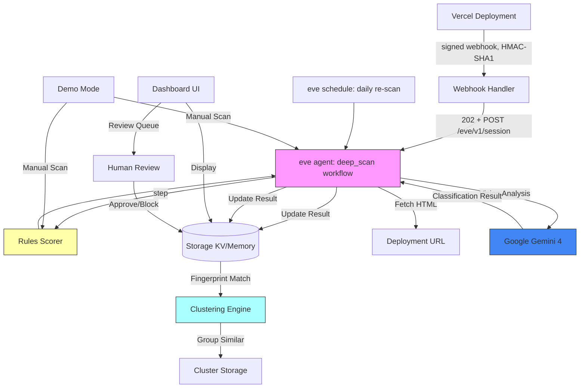

# Trust & Safety Agent for Vercel

A Vercel integration that automatically scans every deployment for phishing and abuse using rules-based detection plus Google Gemini vision analysis. The durable deep scan, the daily re-scan and the scanning agent run on [eve](https://www.npmjs.com/package/eve), Vercel's filesystem-first framework for durable backend AI agents (see [What uses eve](#what-uses-eve)).

**Built for:** CV Gemini 4 Argon Hackathon + Vercel Trust & Safety interview design showcase

## Architecture



## What It Does

### 1. Runtime Rules Check (Fast, Synchronous)
On every deployment webhook. A login form alone is normal, and so is a brand name alone (security blogs, docs), so context signals only count when the page **collects data**:

| Signal | Weight |
|---|---|
| Password form | 0.15 (alone stays clean) |
| Card / SSN / seed-phrase / OTP fields | 0.30 |
| Collects data + a third-party brand in title, headings, buttons, labels or logo alt (not on that brand's domain; "Sign in with Google" SSO buttons ignored) | 0.35 |
| Collects data + form posts to a different site | 0.30 |
| Collects data + urgency language ("suspended", "within 24 hours", "unpaid fee") | 0.15 |
| Typosquat hostname (`paypa1`, `rnicrosoft`) | 0.50 |
| CLI deploy without git / new account (< 7 days) | 0.15 / 0.10 |

Score is capped at 1.0. `__tests__/rules-holdout.test.ts` checks the rules against hand-written pages that are not in the benchmark (SSO buttons, words like "apple" and "chase", off-site form posts), so tuning can't simply memorise the benchmark.

### 2. Two-tier Gemini Scan
- **Tier 1, every deploy:** `gemini-3.8-flash` (low thinking, ~3.5 s, ~$0.0008/scan)
- **Tier 2, escalation only:** `gemini-4-argon` with heavy thinking (`thinkingLevel: 'high'`, ~10 s, ~$0.008/scan) when the Flash score is >= 0.4, the rules score is >= 0.3, or tier 1 fails
- Once Argon runs, its verdict decides the status; rules only decide whether to escalate
- Returns structured JSON: score, impersonated brand, reasons
- Screenshot capture is still stubbed (HTML only)

Configure with `GEMINI_FAST_MODEL`, `GEMINI_DEEP_MODEL`, `GEMINI_FAST_THINKING_LEVEL`, `GEMINI_DEEP_THINKING_LEVEL` and `GEMINI_ESCALATION_THRESHOLD`. "Gemini 3.8 Flash Cyber" is only listed on Google Cloud's Agent Platform (Vertex AI), not in the Gemini Developer API, so the AI Studio key uses `gemini-3.8-flash`.

### Benchmark
`npm run bench` runs a **synthetic** labeled set (`bench/dataset.ts`: 24 phishing kits, 23 benign pages including hard cases such as legitimate login pages and phishing-awareness articles) through rules-only, Flash-only, Argon-only, rules+Argon and tiered configs. Results are in [`bench/results.md`](bench/results.md) and `bench/results.json`. Latest run (Oct 25, 2026):

| Config | Precision | Recall | F1 | FPR | p50 latency | Cost / scan |
|---|---|---|---|---|---|---|
| rules-only | 100.0% | 95.8% | 0.979 | 0.0% | 0.15 ms | $0 |
| flash-only | 100.0% | 100.0% | 1.000 | 0.0% | 4030 ms | $0.00079 |
| argon-only | 100.0% | 100.0% | 1.000 | 0.0% | 8781 ms | $0.00788 |
| rules+argon | 100.0% | 100.0% | 1.000 | 0.0% | 8781 ms | $0.00788 |
| tiered (rules+flash -> argon) | 100.0% | 100.0% | 1.000 | 0.0% | 10091 ms | $0.00538 |

Tiered escalates **51.1%** of samples to Argon: all 24 phishing pages and none of the 23 benign ones. Before the rules rewrite, rules-only had a 34.8% FPR and 68.1% of samples escalated. The one remaining rules-only miss (phish-20, an Okta look-alike with a same-site form and no urgency) is caught by Flash. The set is small and synthetic, so treat 0% FPR as a sanity check, not a production rate. A legitimate shop checkout that collects card numbers, for example, still scores 0.30 and goes to review.

### What uses eve
- `agent/agent.ts`: the eve agent (Gemini 3.8 Flash, direct `@ai-sdk/google` provider).
- `agent/tools/deep_scan.ts`: a durable workflow tool (`"use workflow"`). Each stage is a retryable `"use step"`: fetch HTML, rules, Flash, Argon (only on escalation), then persist with clustering.
- `agent/tools/list_deployments.ts`: lists stored deployments by status for batch re-scans.
- `agent/schedules/rescan.ts`: a daily 06:00 UTC schedule (a Vercel Cron Job) that re-scans `review` and `flagged` deployments.
- `agent/channels/eve.ts`: `/eve/v1/*` behind auth (an `EVE_SCAN_TOKEN` bearer, Vercel OIDC, or localhost in dev).
- `pages/api/webhooks/vercel.ts`: verifies the signature, then starts an eve session (`eve/client`) and returns 202. If eve is unreachable or `EVE_HANDOFF=off`, it falls back to the same pipeline inline.
- `next.config.ts` wraps the app in `withEve()`, so Next serves the UI and API and eve runs as a second service in the same Vercel project. eve needs **Node 24**.

### Webhook signature
Vercel signs the **raw** request body with `hex(HMAC-SHA1(secret, body))` in `x-vercel-signature`. The route disables Next's body parser, checks the raw bytes with `timingSafeEqual`, and parses JSON only after the check passes. For integration webhooks the secret is the integration's Client Secret (set `VERCEL_INTEGRATION_WEBHOOK_SECRET` to it, or rely on the `VERCEL_CLIENT_SECRET` fallback). For account webhooks it is the secret shown when the webhook is created.

### 3. Clustering for Repeat Offenders
- **Exact hash**: SHA-256 of page content
- **SimHash**: Near-duplicate detection (64-bit fingerprint, Hamming distance matching)
- Groups flagged pages into clusters to identify phishing kits used across projects

### 4. Human Review Queue
- Low scores (< 0.3): auto-pass
- Medium (0.3-0.6): human review queue
- High (≥ 0.6): flagged, alerts raised
- Auto-pause (optional, off by default, requires eve human-in-the-loop approval)

### 5. Dashboard
- Recent scans with scores and reasons
- Review queue with approve/dismiss/block actions
- Cluster view showing grouped campaigns
- Metrics: total scans, clean, flagged, clusters

### 6. Demo Mode
- Sample phishing pages (fake PayPal, Microsoft)
- Manual URL scanner
- Full pipeline test without real integration

## Tech Stack

- **Framework**: [eve](https://www.npmjs.com/package/eve) - Vercel's durable agent framework
- **Frontend**: Next.js 16 + React 19
- **Storage**: Upstash Redis via `@vercel/kv` (in-memory fallback for local dev)
- **Models**: Gemini 3.8 Flash (tier 1) and Gemini 4 Argon with heavy thinking (tier 2) via `@ai-sdk/google`
- **Deployment**: Vercel (Workflow + Sandbox + Cron)

## Setup

### Prerequisites
- Node.js 24 (required by eve; `engines.node` is `24.x`)
- Vercel account
- Google Cloud account (for Gemini API key)

### 1. Clone and Install
```bash
git clone https://github.com/DasilvaKareem/trust-safety-agent.git
cd trust-safety-agent
npm install
```

### 2. Environment Variables
Copy `.env.example` to `.env.local`:

```bash
cp .env.example .env.local
```

Required for production:
- `VERCEL_CLIENT_ID` - From Vercel Integration Console
- `VERCEL_CLIENT_SECRET` - From Vercel Integration Console
- `VERCEL_INTEGRATION_WEBHOOK_SECRET` - Webhook signing secret (the integration Client Secret; falls back to `VERCEL_CLIENT_SECRET`)
- `EVE_SCAN_TOKEN` - Bearer token that the webhook uses to start eve sessions
- `GOOGLE_GENERATIVE_AI_API_KEY` - Gemini API key from Google Cloud
- `KV_REST_API_URL` - Upstash Redis URL (or omit for in-memory)
- `KV_REST_API_TOKEN` - Upstash Redis token

For local dev:
- `NEXT_PUBLIC_APP_URL=http://localhost:3000`

### 3. Create Vercel Integration
1. Go to [Vercel Integration Console](https://vercel.com/dashboard/integrations/console)
2. Create new integration:
   - **Name**: Trust & Safety Agent
   - **Redirect URL**: `http://localhost:3000/api/integration/callback` (dev) / your production URL
   - **Webhook URL**: `http://localhost:3000/api/webhooks/vercel` (dev) / your production URL
   - **Events**: `deployment.created`, `deployment.succeeded`
3. Copy Client ID and Client Secret to `.env.local`

### 4. Get Gemini API Key
1. Go to [Google AI Studio](https://aistudio.google.com/app/apikey)
2. Create API key
3. Add to `.env.local` as `GOOGLE_GENERATIVE_AI_API_KEY`

### 5. Set Up Storage (Optional)
For persistent storage:
1. Create [Upstash Redis](https://upstash.com/) database
2. Copy REST API URL and token to `.env.local`

For local dev, omit these vars to use in-memory storage (data lost on restart).

## Development

### Run Locally
```bash
npm run dev
```

Visit `http://localhost:3000`

### Demo Mode
No integration needed:
1. Go to `http://localhost:3000/demo`
2. Select a sample phishing page or enter a custom URL
3. Click "Scan" to run the full pipeline

**Note**: Gemini analysis gracefully skips if no API key is set, returning a mock response.

### Run Tests
```bash
npm test
```

Tests cover:
- Rules scorer (signals, plus hand-written hold-out pages that are not in the benchmark)
- SimHash clustering (Hamming distance, similarity matching)
- Webhook signature: real HMAC-SHA1 over a raw body; rejects re-serialized or tampered bodies, the wrong secret, sha256 digests and missing headers; tests the handler with the body parser off

### Build
```bash
npm run build
```

## Deployment

### Deploy to Vercel
1. Link project:
   ```bash
   npx vercel link
   ```

2. Add environment variables in Vercel Dashboard

3. Deploy:
   ```bash
   npx vercel --prod
   ```

4. Update integration callback URLs to production domain

### Integration Install Flow
1. User installs integration from Vercel marketplace
2. OAuth callback exchanges code for access token
3. Webhook registered for `deployment.*` events
4. Installation stored in KV
5. Future deployments trigger webhook → scan → store → alert

## File Structure

```
.
├── lib/
│   ├── storage/         # KV/in-memory storage layer
│   ├── rules/           # Fast rules-based scorer
│   ├── fingerprint/     # Content hashing + SimHash
│   └── gemini/          # Gemini vision analysis
├── pages/
│   ├── api/
│   │   ├── integration/ # OAuth callback
│   │   ├── webhooks/    # Vercel deployment webhooks
│   │   ├── review.ts    # Review queue actions
│   │   └── demo/        # Demo scan endpoint
│   ├── index.tsx        # Dashboard
│   ├── demo.tsx         # Demo mode
│   ├── clusters.tsx     # Cluster view
│   └── integration/
│       └── success.tsx  # Install success
├── __tests__/           # Jest tests
├── .env.example         # Environment template
└── README.md            # This file
```

## Extending

### Add More Rules
Edit `lib/rules/index.ts`:
- Add keywords to `BRAND_KEYWORDS` array
- Add patterns to typosquat regex list
- Adjust score weights in `computeRulesScore()`

### Change Gemini Models
Set env vars (defaults shown):
```bash
GEMINI_FAST_MODEL=gemini-3.8-flash
GEMINI_DEEP_MODEL=gemini-4-argon
GEMINI_DEEP_THINKING_LEVEL=high
```

### Add Screenshot Capture
Implement `takeScreenshot()` in `lib/gemini/index.ts`:
- Option 1: Playwright in Vercel Sandbox
- Option 2: Third-party screenshot API (ScreenshotOne, Urlbox)
- Option 3: Vercel Serverless Function with Puppeteer

### Enable Auto-Pause
1. Implement eve human-in-the-loop tool (see `eve` docs)
2. Call Vercel API to pause deployment
3. Require approval before action
4. Never auto-pause established accounts

## Demo Script

1. **Start dev server**: `npm run dev`
2. **Visit demo**: http://localhost:3000/demo
3. **Scan fake PayPal**: Select "Fake PayPal Login" → Scan
   - Rules score: 100% (password form + PayPal branding + typosquat)
   - Gemini score: ~90% (if API key set)
   - Status: Flagged
4. **Scan clean page**: Select "Legitimate Banking Site" → Scan
   - Rules score: 0%
   - Status: Clean
5. **View dashboard**: http://localhost:3000
   - See recent scans
   - Review queue (if any medium-risk scans)
6. **View clusters**: http://localhost:3000/clusters
   - See grouped similar pages

## Limitations (MVP)

- Screenshot capture is stubbed (returns `undefined`)
- No real deployment pause (requires HITL approval flow)
- In-memory storage lost on restart (use KV for persistence)
- No user authentication on dashboard (add before production)
- Gemini rate limits not handled
- In-memory storage is per-process: without KV, the Next app and the eve service do not share scan results

## Next Steps

1. Implement screenshot capture with Playwright
2. Add eve human-in-the-loop approval for auto-pause
3. Wire alerting into the eve re-scan schedule
4. Add dashboard authentication
5. Tune Gemini prompt with production examples
6. Add monitoring and alerting (Sentry, Datadog)
7. Implement deployment pause via Vercel API

## License

ISC

## Credits

Built for the CV Gemini 4 Argon Hackathon, showcasing Vercel Trust & Safety interview design.

- **eve**: Vercel's durable agent framework
- **Gemini**: Google's multimodal AI
- **SimHash**: Near-duplicate detection algorithm
- **Vercel**: Hosting and deployment platform
