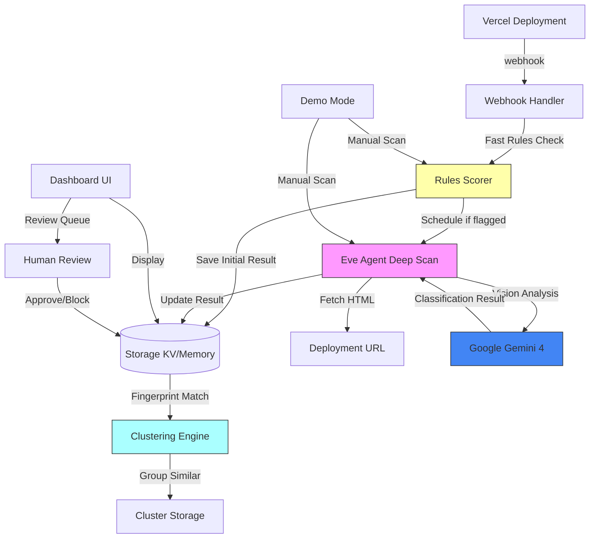

# Trust & Safety Agent for Vercel

A Vercel integration that automatically scans every deployment for phishing and abuse using rules-based detection plus Google Gemini vision analysis. Built with [eve](https://www.npmjs.com/package/eve), Vercel's filesystem-first framework for durable backend AI agents.

**Built for:** CV Gemini 4 Argon Hackathon + Vercel Trust & Safety interview design showcase

## Architecture



## What It Does

### 1. Runtime Rules Check (Fast, Synchronous)
On every deployment webhook:
- **Login form detection**: Searches for `<input type="password">` + form + login keywords
- **Brand keyword matching**: Flags pages with 3+ brand terms (PayPal, Microsoft, etc.) on non-brand domains
- **Typosquatting**: Detects lookalike domains (`paypa1.com`, `g00gle.com`)
- **Metadata signals**: CLI deploys without git source, new accounts (<7 days)
- **Scoring**: Produces a 0-1 risk score with specific reasons

### 2. Deep Gemini Scan (Async, ~60s)
Scheduled for medium/high-risk deployments:
- Fetches deployed HTML
- Takes screenshot (stubbed in MVP)
- Sends to **Google Gemini 2.0 Flash** for multimodal classification
- Returns structured JSON: score, impersonated brand, reasons

### 3. Clustering for Repeat Offenders
- **Exact hash**: SHA-256 of page content
- **SimHash**: Near-duplicate detection (64-bit fingerprint, Hamming distance matching)
- Groups flagged pages into clusters to identify phishing kits used across projects

### 4. Human Review Queue
- Low scores (< 0.3): auto-pass
- Medium (0.3-0.6): human review queue
- High (≥ 0.6): flagged, alerts raised
- Auto-pause (optional, off by default, requires eve human-in-the-loop approval)

### 5. Dashboard
- Recent scans with scores and reasons
- Review queue with approve/dismiss/block actions
- Cluster view showing grouped campaigns
- Metrics: total scans, clean, flagged, clusters

### 6. Demo Mode
- Sample phishing pages (fake PayPal, Microsoft)
- Manual URL scanner
- Full pipeline test without real integration

## Tech Stack

- **Framework**: [eve](https://www.npmjs.com/package/eve) - Vercel's durable agent framework
- **Frontend**: Next.js 16 + React 19
- **Storage**: Upstash Redis via `@vercel/kv` (in-memory fallback for local dev)
- **Model**: Google Gemini 2.0 Flash via `@ai-sdk/google`
- **Deployment**: Vercel (Workflow + Sandbox + Cron)

## Setup

### Prerequisites
- Node.js 22+ (eve requires Node 24, but runs on 22 with warnings)
- Vercel account
- Google Cloud account (for Gemini API key)

### 1. Clone and Install
```bash
git clone https://github.com/DasilvaKareem/trust-safety-agent.git
cd trust-safety-agent
npm install
```

### 2. Environment Variables
Copy `.env.example` to `.env.local`:

```bash
cp .env.example .env.local
```

Required for production:
- `VERCEL_CLIENT_ID` - From Vercel Integration Console
- `VERCEL_CLIENT_SECRET` - From Vercel Integration Console
- `VERCEL_INTEGRATION_WEBHOOK_SECRET` - Webhook signing secret
- `GOOGLE_GENERATIVE_AI_API_KEY` - Gemini API key from Google Cloud
- `KV_REST_API_URL` - Upstash Redis URL (or omit for in-memory)
- `KV_REST_API_TOKEN` - Upstash Redis token

For local dev:
- `NEXT_PUBLIC_APP_URL=http://localhost:3000`

### 3. Create Vercel Integration
1. Go to [Vercel Integration Console](https://vercel.com/dashboard/integrations/console)
2. Create new integration:
   - **Name**: Trust & Safety Agent
   - **Redirect URL**: `http://localhost:3000/api/integration/callback` (dev) / your production URL
   - **Webhook URL**: `http://localhost:3000/api/webhooks/vercel` (dev) / your production URL
   - **Events**: `deployment.created`, `deployment.succeeded`
3. Copy Client ID and Client Secret to `.env.local`

### 4. Get Gemini API Key
1. Go to [Google AI Studio](https://aistudio.google.com/app/apikey)
2. Create API key
3. Add to `.env.local` as `GOOGLE_GENERATIVE_AI_API_KEY`

### 5. Set Up Storage (Optional)
For persistent storage:
1. Create [Upstash Redis](https://upstash.com/) database
2. Copy REST API URL and token to `.env.local`

For local dev, omit these vars to use in-memory storage (data lost on restart).

## Development

### Run Locally
```bash
npm run dev
```

Visit `http://localhost:3000`

### Demo Mode
No integration needed:
1. Go to `http://localhost:3000/demo`
2. Select a sample phishing page or enter a custom URL
3. Click "Scan" to run the full pipeline

**Note**: Gemini analysis gracefully skips if no API key is set, returning a mock response.

### Run Tests
```bash
npm test
```

Tests cover:
- Rules scorer (login forms, brand keywords, typosquats)
- SimHash clustering (Hamming distance, similarity matching)
- Webhook signature verification

### Build
```bash
npm run build
```

## Deployment

### Deploy to Vercel
1. Link project:
   ```bash
   npx vercel link
   ```

2. Add environment variables in Vercel Dashboard

3. Deploy:
   ```bash
   npx vercel --prod
   ```

4. Update integration callback URLs to production domain

### Integration Install Flow
1. User installs integration from Vercel marketplace
2. OAuth callback exchanges code for access token
3. Webhook registered for `deployment.*` events
4. Installation stored in KV
5. Future deployments trigger webhook → scan → store → alert

## File Structure

```
.
├── lib/
│   ├── storage/         # KV/in-memory storage layer
│   ├── rules/           # Fast rules-based scorer
│   ├── fingerprint/     # Content hashing + SimHash
│   └── gemini/          # Gemini vision analysis
├── pages/
│   ├── api/
│   │   ├── integration/ # OAuth callback
│   │   ├── webhooks/    # Vercel deployment webhooks
│   │   ├── review.ts    # Review queue actions
│   │   └── demo/        # Demo scan endpoint
│   ├── index.tsx        # Dashboard
│   ├── demo.tsx         # Demo mode
│   ├── clusters.tsx     # Cluster view
│   └── integration/
│       └── success.tsx  # Install success
├── __tests__/           # Jest tests
├── .env.example         # Environment template
└── README.md            # This file
```

## Extending

### Add More Rules
Edit `lib/rules/index.ts`:
- Add keywords to `BRAND_KEYWORDS` array
- Add patterns to typosquat regex list
- Adjust score weights in `computeRulesScore()`

### Change Gemini Model
Edit `lib/gemini/index.ts`:
```typescript
const model = google('gemini-2.0-flash-exp-001'); // or another model
```

### Add Screenshot Capture
Implement `takeScreenshot()` in `lib/gemini/index.ts`:
- Option 1: Playwright in Vercel Sandbox
- Option 2: Third-party screenshot API (ScreenshotOne, Urlbox)
- Option 3: Vercel Serverless Function with Puppeteer

### Enable Auto-Pause
1. Implement eve human-in-the-loop tool (see `eve` docs)
2. Call Vercel API to pause deployment
3. Require approval before action
4. Never auto-pause established accounts

## Demo Script

1. **Start dev server**: `npm run dev`
2. **Visit demo**: http://localhost:3000/demo
3. **Scan fake PayPal**: Select "Fake PayPal Login" → Scan
   - Rules score: ~75% (password form + brand keywords + typosquat)
   - Gemini score: ~90% (if API key set)
   - Status: Flagged
4. **Scan clean page**: Select "Legitimate Banking Site" → Scan
   - Rules score: 0%
   - Status: Clean
5. **View dashboard**: http://localhost:3000
   - See recent scans
   - Review queue (if any medium-risk scans)
6. **View clusters**: http://localhost:3000/clusters
   - See grouped similar pages

## Limitations (MVP)

- Screenshot capture is stubbed (returns `undefined`)
- No real deployment pause (requires HITL approval flow)
- In-memory storage lost on restart (use KV for persistence)
- No user authentication on dashboard (add before production)
- Gemini rate limits not handled
- No batch re-scanning job (implement as eve schedule)

## Next Steps

1. Implement screenshot capture with Playwright
2. Add eve human-in-the-loop approval for auto-pause
3. Build scheduled batch re-scan job
4. Add dashboard authentication
5. Tune Gemini prompt with production examples
6. Add monitoring and alerting (Sentry, Datadog)
7. Implement deployment pause via Vercel API

## License

ISC

## Credits

Built for the CV Gemini 4 Argon Hackathon, showcasing Vercel Trust & Safety interview design.

- **eve**: Vercel's durable agent framework
- **Gemini**: Google's multimodal AI
- **SimHash**: Near-duplicate detection algorithm
- **Vercel**: Hosting and deployment platform
