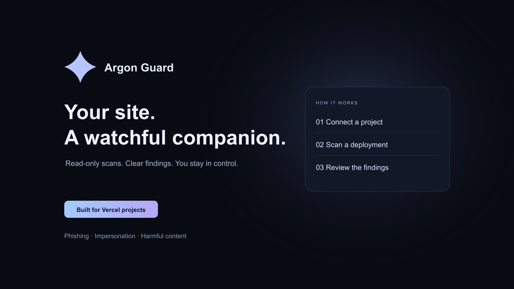

# Argon Guard

[](https://github.com/DasilvaKareem/trust-safety-agent/actions/workflows/ci.yml)

A hackathon website-safety assistant built with Next.js, Neon Auth/Postgres, Google Gemini, and [eve](https://www.npmjs.com/package/eve). Connect a website or selected Vercel projects, scan public pages, and review the evidence behind potential phishing, impersonation, scams, hate, or extremist content.

**[Open Argon Guard](https://argon-guard.vercel.app)** · **[Setup and deployment](DEPLOYMENT.md)** · **[Architecture](docs/ARCHITECTURE.md)** · **[Evaluation results](bench/results.md)**



Built for the CV Gemini 4 Argon Hackathon. This is a working prototype, not a security certification. Scans are read-only; the app does not block or take down deployments.

## What works

- Agent-led onboarding with a mouse-tracking avatar, Google sign-in, and private workspaces.
- Public-URL scans, with ownership verification before enabling monitoring.
- Vercel OAuth connection with read-only project/deployment access and signed deployment webhooks.
- Rules plus a fast Gemini pass, escalating to a deeper model when warranted. Missing/failed AI analysis falls back to rules and is identified in the results.
- Scan history, review decisions, and content groups using SHA-256 and SimHash.
- An outward impersonation search using domain variations, DNS, certificate-transparency records, and content comparison.
- A dark dashboard with a collapsible icon sidebar and mobile drawer.

## Quick start

Requires **Node.js 24** and npm. Use the committed lockfile:

```bash
git clone https://github.com/DasilvaKareem/trust-safety-agent.git
cd trust-safety-agent
npm ci
cp .env.example .env.local
npm run dev
```

Open [localhost:3000/onboarding](http://localhost:3000/onboarding). To sign in and use the dashboard or `/demo` UI, configure Neon Auth and storage using the [deployment guide](DEPLOYMENT.md). Without credentials, you can still run unit tests and the fixed, server-side sample API:

```bash
curl http://localhost:3000/api/demo/scan \
  -H 'Content-Type: application/json' \
  -d '{"sample":"fake-paypal"}'
```

Anonymous sample requests are rate-limited and cannot submit arbitrary HTML or fetch an arbitrary URL. With no Gemini key, this returns a rules-only result. In-memory results disappear on restart; shared deployed services need durable storage.

## Connect your site

1. Sign in at **[Connect a site](https://argon-guard.vercel.app/onboarding?step=connect)**.
2. Choose **Connect Vercel**, authorize your team and selected projects, then choose a project in Argon Guard. Start from the app so the OAuth callback has a valid account-bound state.
3. Or choose **Add any website** and paste a public URL. To enable monitoring, publish the generated verification file at `/.well-known/trust-safety.txt`.
4. Run a scan and review its findings. “Clean” means the scanner found no sufficient signals, not that the site is guaranteed safe.

Vercel monitoring scans successful, ready **production** deployments for connected projects. Other website monitoring is an on-demand batch: **no scheduled cron is deployed**. Disconnecting a site stops its monitoring; uninstalling the integration in Vercel revokes access. Scan-history deletion is separate.

## Development checks

```bash
npm test -- --runInBand
npm run build
npm audit --omit=dev
```

The build applies the idempotent application migration **if a database URL is present**; without one, it skips migrations. Use a development database for local work. GitHub CI runs tests and a credential-free build on pushes and pull requests.

Tests cover scan rules and categories, content fingerprints, impersonation detection, session validation, OAuth replay protection, account isolation, request-origin checks, ownership verification, and webhook signatures. Live Google/Vercel authorization still needs a manual smoke test with configured providers.

## Documentation

| Guide | Contents |
| --- | --- |
| [Deployment](DEPLOYMENT.md) | Environment variables, Neon/Google auth, Vercel integration, deployment and troubleshooting |
| [Architecture](docs/ARCHITECTURE.md) | Actual request paths, storage, authentication, API access, and eve’s role |
| [Scanning and evaluation](docs/SCANNING.md) | Detection policies, scoring, model settings, benchmark commands and limitations |
| [Benchmark report](bench/results.md) | Recorded measurements, dataset provenance, costs, and caveats |
| [Hate/extremism demo](bench/live-hate-demo.md) | Demonstration fixtures and walkthrough |
| [Impersonation demo](bench/live-impersonation.md) | Outward-search walkthrough |
| [Optional scheduling example](examples/scheduled-rescan.md) | Future cron wiring; not active deployment configuration |
| [Contributing](CONTRIBUTING.md) | Local workflow and pull-request checks |
| [Security](SECURITY.md) | Private reporting and secret-handling guidance |

## Repository map

```text
agent/                  eve agent, authenticated channel, durable scan tools
components/             Avatar, onboarding, site controls, workspace shell
lib/account/            Sessions, site ownership, OAuth, safe public-page fetching
lib/auth/               Neon SDK client, server adapter, and configuration
lib/database/           Neon persistence
lib/rules/              Rules-based detection
lib/gemini/             Tiered model analysis and fallback behavior
lib/impersonation/      Domain generation, discovery, comparison, and model judge
lib/fingerprint/        Exact and near-duplicate content fingerprints
lib/scan/               Shared scan pipeline
lib/storage/            Scan storage facade (Neon, legacy Redis, memory)
pages/api/              Auth, sites, scans, integration callbacks, webhooks
migrations/             Application schema (not Neon’s managed auth schema)
__tests__/              Jest unit and integration-style tests
bench/                  Synthetic fixtures and recorded evaluation reports
```

## Current limits

- Screenshot capture is stubbed; current scans analyze HTML, not rendered browser screenshots.
- Gemini model names are hackathon defaults; availability depends on your account. Override them with models you can access.
- No automatic takedown, deployment pause, email alerts, or deployed cron schedule.
- No full-site crawl: a website scan checks the submitted page, with bounded size and timeouts.
- IPv6-only hosts and nonstandard ports are unsupported by the public-page fetcher.
- Rule/AI verdicts can be wrong; similarity alone is not evidence of phishing.
- The Vercel authorization screen has been verified live; completing installation and a subsequent deployment scan requires selecting a project.
- Production hardening, operational alerting, and broader abuse/load testing remain future work.

## License and attribution

Source code is [MIT licensed](LICENSE). Hosted-service terms are separate at [/terms](https://argon-guard.vercel.app/terms), [/privacy](https://argon-guard.vercel.app/privacy), and [/support](https://argon-guard.vercel.app/support).

The avatar includes upstream Morph Bot code; see [source and license notices](public/morph-bot/SOURCE.md) and the bundled vendor notices. Benchmark dataset provenance and usage restrictions are documented in [the evaluation report](bench/results.md).
