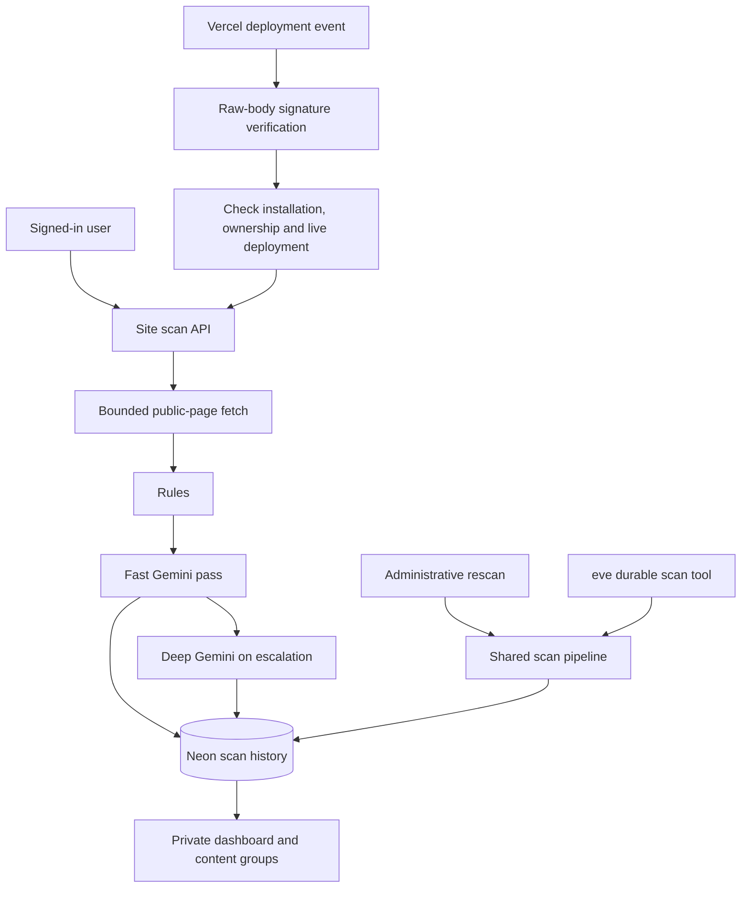

# Architecture

[Back to README](../README.md)

## Actual scan paths

The current Vercel webhook handler **awaits `runSiteScan()` inline** and returns 200 after processing, or 500 on failure so delivery can retry. It does not currently return 202 or hand requests to eve. A 24-hour site/deployment claim deduplicates deliveries and is released on scan failure. Only active owner-scoped installations, verified monitored sites, and live READY production deployments are scanned.

`agent/tools/deep_scan.ts` separately implements an eve durable workflow with retryable steps. `withEve()` mounts that agent as a second Vercel service at `/eve/v1/*`. Its channel accepts the server-side scan token, Vercel OIDC, or local development authentication. The administrative `/api/rescan` route calls `lib/scan/pipeline.ts` directly. No scheduler is configured.

## Accounts and connections

Google sign-in runs through the Neon SDK. `/api/auth/[...path]` proxies auth operations; `proxy.ts` finalizes the OAuth verifier at `/auth/complete`. Private routes validate the upstream session, require verified email, and scope data access to the user. Browser mutations check the application origin.

Vercel OAuth uses browser-bound, expiring one-time state. The callback exchanges the code and stores an encrypted token against the authenticated owner. The project-selection API queries Vercel using that token; it does not trust a client-submitted deployment URL. Installation removal clears the token and pauses connected sites.

Public-site ownership is verified by an exact token file at `/.well-known/trust-safety.txt`. The fetcher validates DNS, pins public IPv4 connections, validates redirects, and limits response size/time. It does not crawl the whole site or render a browser.

## Storage

- Neon owns authentication tables in `neon_auth`.
- `migrations/001_argon_guard.sql` creates app records, set membership, and indexed deployment JSON in `argon_guard`.
- Record expiry, one-time consumption, and scan locks use database operations rather than process-only locks when Neon is configured.
- Legacy Redis is supported when Neon is absent. Memory is a hackathon fallback and is neither durable nor shared across processes.
- Account ownership filters exclude unowned legacy records from customer workspaces.
- Disconnect removes the site record; existing scan history remains. Deletion requests require separate handling.

## API access map

| Route | Access and purpose |
| --- | --- |
| `/api/auth/*` | Neon sign-in/session operations; same-origin mutation checks |
| `/api/sites`, `/api/sites/[id]` | Signed-in owner; create, scan, verify, monitor, disconnect |
| `/api/integration/start` | Signed-in user; creates OAuth state |
| `/api/integration/callback` | Active session plus one-time OAuth state/code |
| `/api/integration/projects` | Owner of the active Vercel installation |
| `/api/webhooks/vercel` | Vercel HMAC-SHA1 signature over raw body |
| `/api/demo/scan` | Anonymous fixed server-side samples; custom input/fetch requires sign-in |
| `/api/impersonation/find` | Signed-in scans, with limited rate-controlled demo exceptions |
| `/api/review` | Signed-in owner’s review decisions; no deployment takedown |
| `/api/sites/monitor` | Administrative `CRON_SECRET` bearer; on-demand batch |
| `/api/rescan` | Administrative `EVE_SCAN_TOKEN` bearer; on-demand rescan |
| `/eve/v1/*` | Service token, Vercel OIDC, or local development auth |

The `/demo` page itself requires sign-in even though its fixed sample API has an anonymous path. Fixture routes under `/fixtures/*` serve synthetic content with `noindex`.

## Detection and interpretation

Rules score the fetched HTML and URL. The fast model runs when configured; the deep model runs on escalation. A completed deep verdict takes precedence; provider failures produce an explicit fallback. Current model IDs and thresholds are configurable in `lib/gemini/index.ts` and `.env.example`.

SHA-256 supports exact matches; 64-bit SimHash supports approximate grouping. Content groups can contain clean scans and single scans. Group membership does not establish malicious intent. The dashboard reports findings for human review and does not change the monitored site.

Impersonation search generates bounded lookalike candidates, optionally queries certificate transparency, validates public addresses, fetches bounded content, and compares/judges candidates. Empty results are valid; provider/network failures limit coverage. See [scanning and evaluation](SCANNING.md) and the implementation under `lib/impersonation/`.
